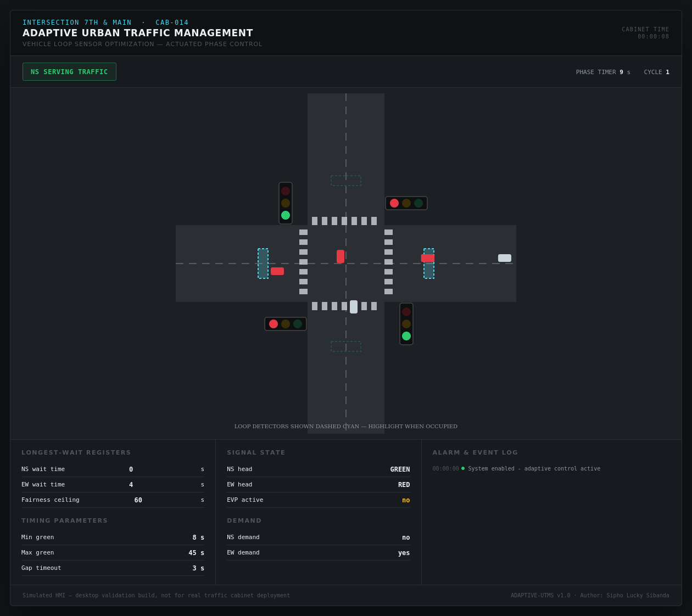
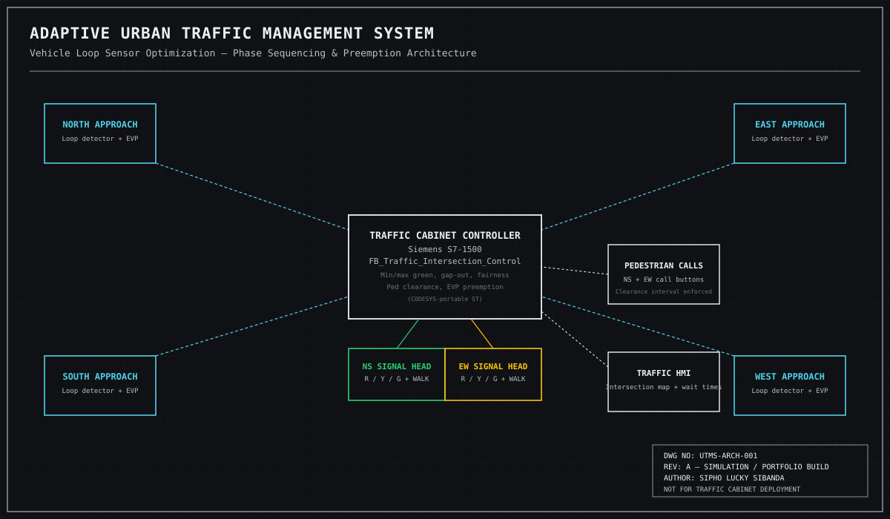

# 🚦 Adaptive Urban Traffic Management System (UTMS)
### with Vehicle Loop Sensor Optimization


**Author:** Sipho Lucky Sibanda
**Series:** Automation Skills Portfolio — Civil Engineering Technology (Transportation)
(a sixth discipline shift — the same PLC engineering discipline applied to real-time public infrastructure)

---

## 🚦 Context — Why This Matters

A fixed-time traffic signal gives every approach the same green regardless of whether
anyone is actually there — wasting cycle time on an empty street while the opposite
approach queues up. An *actuated* signal reads in-pavement loop detectors and adapts
in real time: extending green only while vehicles keep arriving, cutting it short once
the stream dries up, and never letting any approach wait indefinitely. This project
simulates exactly that control problem, using the real vocabulary of NEMA-style
actuated traffic control.

## 🔧 What This Project Does

`FB_Traffic_Intersection_Control` is a PLC function block (IEC 61131-3 Structured Text) that:

- Runs **genuinely actuated phase control**: minimum green, maximum green, a vehicle
  extension "gap" timer, and gap-out logic — the standard vocabulary real traffic
  cabinet controllers use
- Tracks a **longest-wait register per direction** (accumulating only while that
  direction has real demand and isn't green) and uses it for a **fairness override** —
  cutting a green short, once its minimums are met, when the other direction's wait
  crosses a ceiling
- Enforces **pedestrian clearance**: once a WALK indication is given, the signal may
  not leave green until a pedestrian already in the crosswalk has had time to finish
- Handles **emergency vehicle preemption**: a safe (not abrupt) transition through
  all-red into a hold-green for the requesting direction, then a clean recovery —
  never cutting a pedestrian clearance interval short, even for an ambulance
- **Rests in green or all-red** when there's no demand, rather than cycling through
  empty phases

## 🖥️ HMI — Live Intersection Map

The `index.html` mockup is a top-down 4-way intersection with animated cars,
in-pavement loop detector pads that light up when a car sits on them, signal heads
that reflect the live phase, longest-wait registers, and a scripted emergency
preemption event partway through the demo.



## 🗺️ System Architecture



## ⚙️ Key Engineering Concepts

| Concept | How it's implemented |
|---|---|
| Actuated control | Min green, max green, vehicle extension gap timer, gap-out |
| Longest-wait fairness | Per-direction wait registers driving an early-termination override |
| Pedestrian clearance | A hard minimum no vehicle-side logic is allowed to shortcut |
| Emergency preemption | Safe transition via all-red, hold, then recovery from a clean state |
| Demand-responsive resting | No wasted cycles through phases with nobody waiting |

## 📁 Repository Structure

```
traffic-adaptive-utms/
├── README.md
├── src/
│   └── Traffic_Intersection_Control.st   # IEC 61131-3 Structured Text signal logic
├── docs/
│   ├── IO_List.md                        # Full I/O list
│   └── Testing_Procedures.md             # FAT-style functional test cases
├── hmi/
│   └── index.html                        # Animated intersection map
└── images/
    ├── architecture_diagram.svg          # Control architecture diagram
    └── hmi-dashboard.png                 # Rendered HMI screenshot
```

## 📄 Documentation

- [I/O List](IO_List.md)
- [Functional Test Procedures](Testing_Procedures.md)
- [Full Technical Manual (PDF)](Traffic_Technical_Manual.pdf) — 25-page project ebook covering actuated-vs-fixed-time signal context, architecture, hardware, the gap-out / longest-wait fairness / preemption control philosophy, full annotated code, HMI design, alarm philosophy, testing/commissioning, and a HAZOP-style hazard register

## ⚠️ Disclaimer

This is a **simulation and portfolio project**. It is not certified, has not been
tested against real hardware, and must not be used as a basis for an actual traffic
signal controller. A real installation requires a conflict monitor (an independent
hardware safety device that forces a safe flashing state on any conflicting-green
fault), yellow/all-red timing derived per ITE guidance, and approval from the
responsible road authority.

## 👤 Author

**Sipho Lucky Sibanda**
Automation & Controls Portfolio — Marine, Avionics, Architectural, Applied AI, Biotech, Electrical, Civil &amp; Industrial Systems

---
